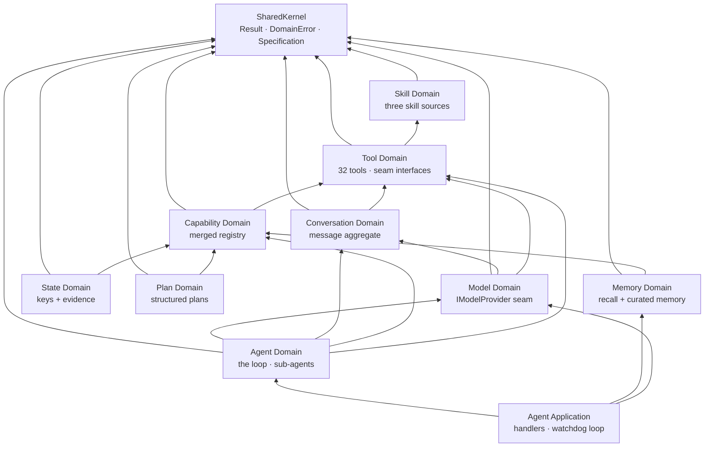
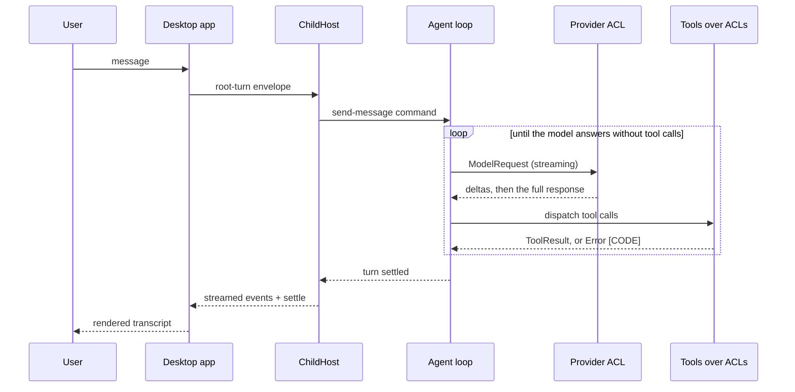
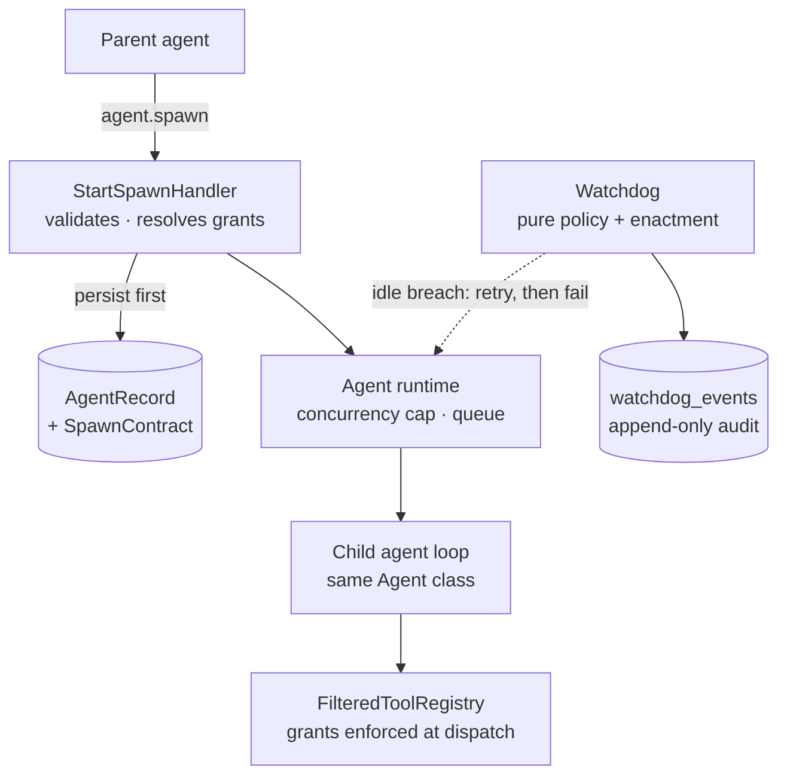
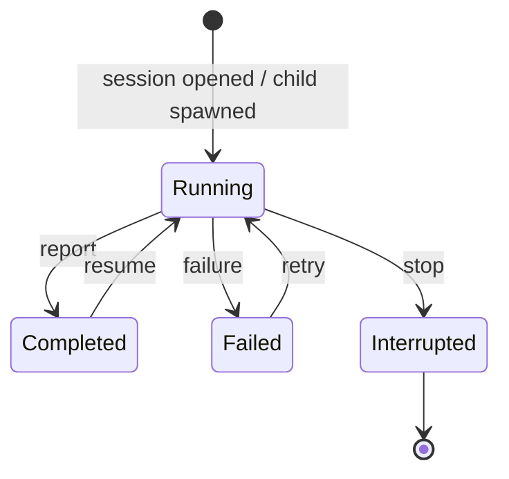

import PostTable from "../../../components/ui/PostTable.astro";

[eThang Agent](https://github.com/eglove/ethang-agent) is an agent harness for Windows: the scaffolding an AI model acts through. Written in C# on .NET 10, shipped as an Avalonia desktop app. The source is 27 projects and about 77,000 lines, with another 96,000 lines of tests behind them. This post is a tour of how the pieces fit. It stays at the architectural level: what each part owns, how it connects to the rest, and why the boundaries are drawn where they are. The mechanisms behind each seam are in the source; the shape is here.

<figure className="my-4">
  
  <figcaption className="text-xs text-night-owl-muted text-center mt-1">
    The layer map: one frontend, one composition root, nine bounded contexts, ten anti-corruption layers.
  </figcaption>
</figure>

## One rule everything follows

The codebase has one rule that explains nearly every file in it: a domain never touches the outside world directly. File I/O, HTTP, SQLite, Roslyn compilation, UI automation: none of it appears inside a bounded context. Each external system sits behind an interface the domain owns, and an anti-corruption layer (ACL) implements that interface on the other side.

The pattern is small. The file-system seam is three methods:

```csharp
public interface IFileSystemAccess
{
  Task<Result<FileRead>> ReadLinesAsync(string path, int startLine, int endLine, CancellationToken ct = default);
  Task<Result<byte[]>> ReadBytesAsync(string path, CancellationToken ct = default);
}
```

The interface lives in the Tool Domain. `DirectFileSystemAccess` implements it in the FileSystem ACL. The domain calls the interface; it cannot name the implementation, because the reference runs the other way. Swap SQLite for Postgres, Roslyn for anything else, OpenRouter for any provider that can express messages and tool calls, and no domain file changes.

Failures cross the same seam as data. `Result<T>` carries either a value or a `DomainError` (a stable code plus a message); expected failures are return values, and exceptions are reserved for programmer error. A tool that fails hands the error back to the model as a tool result, where the model can read it and self-correct.

## The middle band: nine bounded contexts

Each concern is owned by exactly one project. The dependency graph between them is shallow and points one way:

<figure className="my-4">



<figcaption>The bounded contexts and what they depend on. Arrows point from dependent to dependency; nothing cycles.</figcaption>
</figure>

The big ones:

- **Agent Domain** — the loop, tool dispatch, and the whole sub-agent system: spawn contracts, grants, mailboxes, the watchdog policy. The largest domain at about 7,200 lines.
- **Tool Domain** — the tool contracts and 32 built-in tools, from `read` and `edit` to `docx`, `pdf`, git, MCP dispatch, and the skill tools. It also owns the seam interfaces every ACL implements, which is why ten different ACL projects all reference this one project and nothing else of the domain's.
- **Conversation Domain** — the `Conversation` aggregate: an ordered message list whose `Compact` method validates a replacement before mutating (tool calls must keep their results; non-empty; no dangling ids).
- **Model Domain** — provider-neutral model requests and responses, the `IModelProvider` seam, model resolution, and context accounting.
- **Capability Domain** — the registry that merges tool providers and exposes them to the model, plus the filtering wrapper that enforces per-child grants.
- **Skill, State, Memory, Plan Domains** — the smaller stores: methodology skills, durable workspace key-value state with evidence-carrying transitions, transcript recall and curated memory, structured plans.

A `SharedKernel` project holds the base types everything shares: `Result<T>`, `DomainError`, the `Specification<T>` base for composable business rules.

Two conventions hold across all of them. Domains prefer immutable records and copy-on-write mutations. And each project follows the same internal layering: domain types at the core, application services (commands, queries, handlers) around them, infrastructure at the edge.

## The agent loop

The heart of the Agent Domain is one class, `Agent`, with one method that matters. `RunTurnAsync` is a `while (true)` loop with no iteration cap:

<figure className="my-4">
  
  <figcaption className="text-xs text-night-owl-muted text-center mt-1">
    One turn: context management, one provider call, then either finish or execute tools and go around again.
  </figcaption>
</figure>

Each iteration drains the steering inbox, manages context pressure, snapshots the conversation into a `ModelRequest`, and sends it through `IModelProvider`. A response with no tool calls ends the turn. A response with tool calls appends the assistant message, executes each call, appends each result, and loops.

Termination is the model's job; the loop only enforces the guardrails around it. Cancellation is checked every round. A repeat guard watches for identical calls repeating past a threshold and ends the turn with a named error. Every tool call carries a mandatory time budget, and an over-budget call returns `Error [ToolTimeout]` as a result the model can react to.

Context pressure is handled in the same loop. A pure `CompactionPolicy` derives three thresholds from the model's context window (bigger windows act earlier and land lower), and at the ceiling a compactor evicts the oldest exchanges, has a cheap summarizer model write a dense handoff note, and replaces the prefix through `Conversation.Compact`.

## Anatomy of a turn

Putting the layers together, one user message travels like this:

<figure className="my-4">



<figcaption>A root turn. The app never runs agent work itself; it forwards the turn to the conversation's host process and renders what comes back.</figcaption>
</figure>

The point of the diagram is the direction of translation. The user speaks to the app; the app speaks wire envelopes to the host; the host speaks domain commands to the loop; the loop speaks provider-neutral requests to the provider ACL; the provider ACL speaks HTTP to OpenRouter. Each boundary has its own language, and each translation is one file's job.

## The tool surface

The model sees one flat list of tools, but the registry behind it is a merge of several sources. `ITool` implementations (the 32 built-ins) sit on the loop registry. Capability providers (agent operations, state, plans, memory recall) expose action vocabularies through a second registry. A `MergedCapabilityProvider` unions them, and a `CapabilityRegistry` validates the result at construction: no duplicate ids, no duplicate action names, no empty providers.

Every tool declares its parameters, its required keys, and its output contract in its definition. That definition is what the model receives; the same object validates the call at dispatch. A tool's error text is written for the model to act on, not for a log: a failed edit quotes the nearest matching region so one retry corrects the anchor.

Two structural choices keep the surface manageable. First, MCP servers enter the registry as one dispatch tool however many are configured, so the definition budget stays flat. Second, the exec tool is one tool that runs a whole C# program, letting the model compose reads, writes, tests, and commits inside a single budgeted call instead of paying a tool-call round trip per step.

## The sub-agent system

The sub-agent system rests on one idea: the root session is itself just an agent record at depth zero. A spawned child is the same persisted shape with a parent id and a depth. Everything else follows from that uniformity.

<figure className="my-4">



<figcaption>Spawning persists the contract before anything runs; the runtime enforces it for the whole run; the watchdog supervises with facts, not guesses.</figcaption>
</figure>

A spawn request unfolds into a `SpawnContract`: an optional JSON schema the child's final report must satisfy, tool allow/deny grants, budget ceilings, and a steering urgency cap. The contract is persisted with the record before the run starts, so resume and audit see the agreement the run started with, and an out-of-process host can enforce it without trusting the parent's word.

Grant resolution follows one rule: privilege cannot grow down the tree. A child's effective tool set is its parent's set narrowed by the grants; a spawn that tries to widen fails outright. Enforcement is not a check at the door: the child's entire registry is wrapped in a filter, so every dispatch of every tool call passes through the grant decision.

Children are spawned without blocking, awaited with one action, steered mid-run through bounded mailboxes, and resumed for fix rounds on the same id. A watchdog supervises every running child: a pure policy turns facts (idle age, retry attempts) into decisions, the application layer enacts them, and every decision lands in an append-only audit table. There is deliberately no wall-clock timeout; cancellation comes only from an explicit interrupt, a watchdog terminal decision, or a budget ceiling.

## The bottom band: ten anti-corruption layers

Ten ACL projects, each implementing domain-owned interfaces:

<PostTable
  headers={["ACL", "Translates for"]}
  rows={[
    ["OpenRouter", "the provider wire: Responses API requests, SSE streams, the model catalog"],
    ["Roslyn", "the exec tool: model-written C# compiled and run in-process"],
    ["FileSystem", "all file I/O, git, shell access"],
    ["Storage", "every persistence seam over one SQLite database"],
    ["Transport", "the named-pipe protocol to the out-of-process host"],
    ["Web", "web_fetch over HTTP(S)"],
    ["Documents", "the docx wire format"],
    ["PDF", "the PDF wire format"],
    ["ComputerUse", "Windows desktop automation"],
    ["MCP", "the Model Context Protocol"],
]}
/>

Two carry the tightest constraints. The Roslyn ACL runs model-authored C# in-process, which is a memory leak waiting to happen under Roslyn's default scripting behavior; the engine emits each run into a per-run collectible assembly context that unloads when the run settles. The Storage ACL owns one SQLite database with 17 versioned migrations; the out-of-process host opens the same file as a guest, without migrating, so two processes never fight over the schema lock.

The ACL rule has one refinement: ACLs share no domain code, but provider wire plumbing (request building, stream parsing) may live in a shared infrastructure project, because that logic is wire-shaped rather than domain-shaped. That is the `Provider.Wire` project.

## The composition root

Nothing wires itself. `eThangAgent.Composition` is a host-agnostic library that registers every implementation against every interface: about 4,800 lines of DI wiring in one place. Domains depend only on interfaces and contain zero container references; the frontend supplies exactly three decisions (provider, workspace, host options) and gets back an isolated `AgentSession` with its own DI container, conversation, and workspace identity.

The system prompt is assembled the same way: a composite provider concatenates the skills listing, the session identity, the exec guide, the memory guide, and the context-hygiene guidance, each a small class the composition root orders. Because the same composition library serves the desktop app and the out-of-process host, a remote child renders the identical prompt as an in-process one.

## Three processes, one database

The desktop app is not the only process. Every conversation runs in its own out-of-process host:

<figure className="my-4">
  
  <figcaption className="text-xs text-night-owl-muted text-center mt-1">
    The process map: one host per conversation over a named pipe, a killable broker for desktop automation, one shared database.
  </figcaption>
</figure>

`eThangAgent.ChildHost` is a small executable (about 1,600 lines) that owns the conversation's real agent loop. When you send a message, the app forwards it over the pipe as a `root-turn` envelope; the host runs the turn through the same composition the app would have run, streaming deltas, tool activity, and a settle event back. The app does no agent work for such a turn; it renders what the host streams. Every failure on that wire is typed (`HostUnavailable`, `TurnCancelled`, `TurnCeilingExceeded`), so a caller is never left waiting on a silent connection.

The ComputerUse broker follows the same shape for a different reason: UIA tree-walking and input injection are native Windows operations that can crash, so they live in a killable process the domain never knows about, behind one `IComputerAccess` seam.

Both hosts open the app's SQLite file as guests. Sessions, transcripts, and audit rows survive an app restart; a relaunching app re-attaches to a still-running host on the same pipe and reconciles what it finds.

## Sessions and their lifecycle

Every conversation is a persisted agent record, and the record's status drives what the system can do with it:

<figure className="my-4">



<figcaption>One lifecycle for roots and children alike. Resume replays the persisted transcript; the conversation continues where it stopped.</figcaption>
</figure>

Persistence is incremental, not terminal: every message flows to the store at the moment it is added, so an interrupt or crash leaves the transcript persisted up to the last safe point. Compacted sessions persist by whole-transcript replacement and resume like any other. A workspace can hold many sessions; resuming one never merges another's history.

Around the records sit the durable stores the agent itself can use: workspace-scoped state keys, structured plans, curated memory, and full-text recall over past transcripts. All of them are interfaces in their domains, implemented by the Storage ACL, and exposed to the model as capability providers. The database is part of the agent's working memory, not an archive it cannot read.

## Why boundaries this strict

The test suite is the argument for the shape. Domain tests use fakes only; a domain test never knows Roslyn, HTTP, or OpenRouter exist. Integration tests exercise the real ACL implementations. E2E tests drive the desktop app headless against a local mock provider server. That split is only possible because every external dependency sits behind a seam the domain owns: the fakes implement the same interfaces the ACLs do.

The other payoff is swap-ability. The provider is already behind a seam, so a second provider is a new ACL project plus a registry entry, not a refactor. The storage engine is swappable the same way. The long-range plan of alternative frontends and platforms stays open, because nothing in the domain would have to change to serve them.

Strict boundaries are not free: ten ACL projects is real overhead for a codebase this size, and the wire protocols between processes are versioned by build rather than negotiated. The bet is that an agent harness lives for years, gets extended constantly, and its cost center is change, and seams are what keep change cheap.

---

*The full source is at [eglove/ethang-agent](https://github.com/eglove/ethang-agent). The architecture rules this post describes are enforced by tests, analyzers, and one long engineering handbook (`AGENTS.md`) that the codebase must keep current.*
